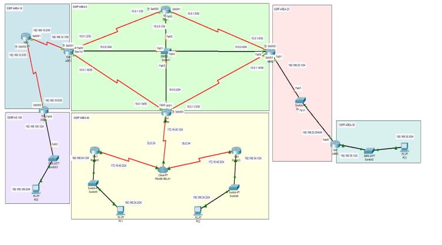

# Advanced Computer Networking – Routing and Frame Relay Project

## Overview

A collaborative academic networking project developed as part of the Advanced Computer Networking course (CIT 3502) during the First Semester of the 2024–2025 academic year at the Islamic University of Madinah.

The project focuses on configuring and verifying a multi-area network topology using different routing protocols and networking technologies, including OSPF, EIGRP, RIP, and Frame Relay.

The network consists of multiple routers, switches, and PCs connected across different routing domains and OSPF areas. The main objective is to establish connectivity between network segments and verify communication between routers and end devices.

## Project Objectives

- Configure OSPF on routers using Process ID 1.
- Configure router IDs using loopback addresses.
- Advertise directly connected networks in the appropriate OSPF areas.
- Configure loopback interfaces.
- Verify router connectivity by pinging the loopback addresses of other routers.
- Verify connectivity between PCs across remote networks.
- Configure RIP routing on the given topology.
- Configure EIGRP Autonomous System 100.
- Configure Frame Relay connections between routers.

## Network Topology

The project topology consists of multiple routing domains and OSPF areas.

### Routing Domains and OSPF Areas

| Network Area | Devices | Description |
|---|---|---|
| EIGRP AS 100 | ASBR, Switch3, PC0 | Implements EIGRP and connects the EIGRP domain to the routing topology. |
| OSPF Area 10 | ASBR, Router1, ABR1 | Connects the EIGRP domain with the OSPF backbone. |
| OSPF Area 0 | ABR1, BBR1, ABR2, ABR4, Switch1 | Acts as the OSPF backbone for inter-area routing. |
| OSPF Area 40 | ABR4, Router2, Router3, Switch5, Switch6, PC1, PC2 | Implements Frame Relay connectivity and communication with other areas. |
| OSPF Area 23 | Switch4, ABR2, ABR3 | Provides connectivity between Area 0 and Area 30. |
| OSPF Area 30 | ABR3, Switch2, PC3 | Provides connectivity for PC3 and communication with other areas. |

### Network Topology Diagram

The following image illustrates the overall network structure and the connections between routers, switches, and PCs.

## Technologies and Protocols

### 1. OSPF (Open Shortest Path First)

OSPF was configured using Process ID 1 across the routers, with different areas to organize the network and support inter-area routing.

The project includes:

- OSPF Area 0 (Backbone).
- OSPF Area 10.
- OSPF Area 23.
- OSPF Area 30.
- OSPF Area 40.
- Router ID configuration.
- Loopback interfaces.
- Network advertisement.
- Connectivity verification.

### 2. EIGRP (Enhanced Interior Gateway Routing Protocol)

EIGRP was configured with Autonomous System Number 100 to support routing within the EIGRP domain and its connection to the wider topology.

### 3. RIP (Routing Information Protocol)

RIP Version 2 was configured on the routers as part of the routing requirements.

### 4. Frame Relay

Frame Relay encapsulation and DLCI configuration were implemented to establish connectivity between ABR4, Router2, and Router3.

## PC Configurations

The following screenshots demonstrate the IP configuration of the four PCs connected to the network.

### PC0 Configuration

### PC1 Configuration

### PC2 Configuration

### PC3 Configuration

## Frame Relay Configuration

The following screenshot demonstrates the Frame Relay configuration used in the network.

## Routing Configuration and Verification

The following screenshots demonstrate routing verification across the different routers and areas.

### ASBR Verification

### ABR1 Verification

### ABR2 Verification

### ABR3 Verification

### ABR4 Verification

### BBR1 Verification

### Router1 Verification

### Router2 Verification

### Router3 Verification

## Team Collaboration

This project was completed as a collaborative academic group project.
The project involved configuring network devices, implementing routing protocols, establishing network connectivity, and verifying communication across the different network segments.

